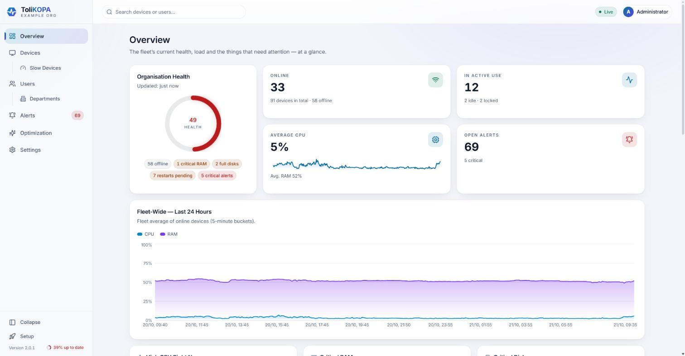
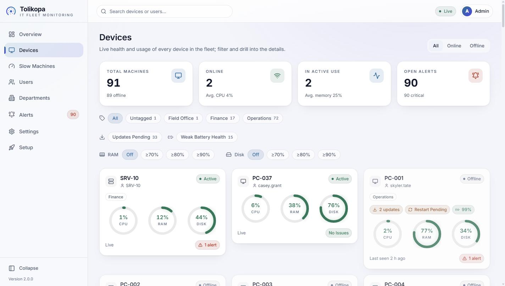
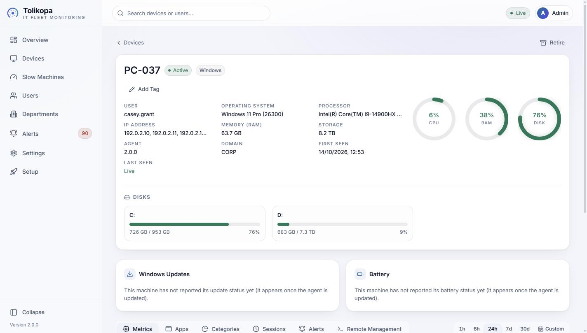
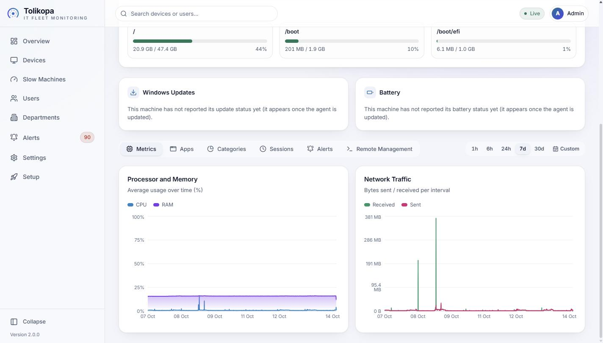
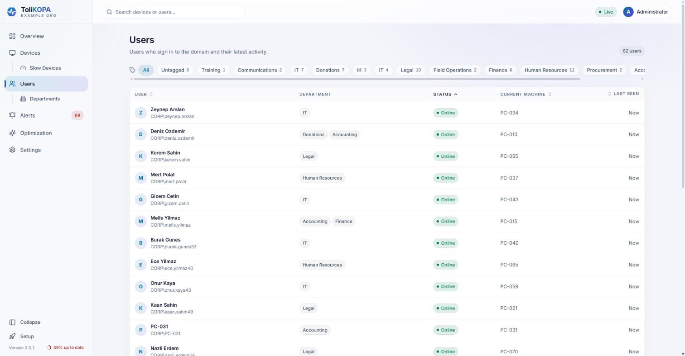
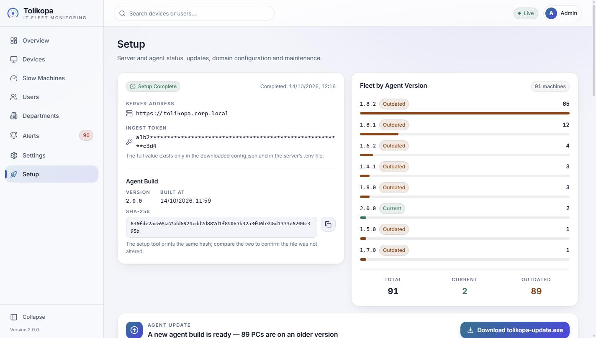

<p align="center">
  <picture>
    <source media="(prefers-color-scheme: dark)" srcset="docs/logo-dark.svg">
    
  </picture>
</p>

# ToliKOPA — IT Fleet Monitoring

A lightweight, privacy-respecting system that centrally monitors the **hardware health and general
usage** of domain-joined computers. It consists of a small agent pushed silently to every PC via
Group Policy, a collection/database layer running on an Ubuntu server on the same network, and a
modern, animated web admin panel.

> **Privacy:** Screen contents, keystrokes, window titles, URLs and file names are **never
> collected**. Only aggregate system metrics (CPU/RAM/disk/network), process name + category, the
> logged-on username and hardware health are collected. Details: [`docs/AGENT.md`](docs/AGENT.md).

## What does it monitor?

- Live CPU / RAM / disk usage and disk fill levels
- The applications consuming the most resources (name + category + CPU/RAM only)
- Failing hardware (disk SMART) and alerts for crashing/hanging programs
- When PCs are actively in use (session state)
- Classification by program type (browser / office / development / media / ...)
- Network (upload/download) usage per username — on a timeline

## Screenshots

Taken from a live installation; machine names, user names, departments and addresses are replaced
with placeholders.



| Devices | Machine details |
|---|---|
|  |  |
| **Machine history (7 days)** | **Users** |
|  |  |



## Architecture

```
Windows PCs (Tolikopa agent, Windows service)
        │  HTTPS batch  ─────────────►  Ubuntu server
                                        ├─ Caddy (TLS + SPA + reverse proxy)
                                        ├─ API   (Go + Echo)
                                        └─ TimescaleDB (PostgreSQL 17)
Admin browser  ◄── React panel (live WebSocket)
```

## Repository layout

- [`agent/`](agent/) — Go agent (Windows + Linux). A single static binary, no installer UI.
- [`server/`](server/) — Go backend: ingest, REST/WebSocket API, alert engine.
- [`web/`](web/) — Vite + React + TypeScript admin panel.
- [`setup/`](setup/) — `tolikopa-setup.exe` / `tolikopa-update.exe`: domain rollout tool (Go), downloaded from the panel as a zip with its bundle.
- [`deploy/`](deploy/) — Docker Compose, Caddy, GPO scripts.
- [`setup.sh`](setup.sh) — Ubuntu server installation and updates.
- [`docs/`](docs/) — technical documentation (see below).
- [`CLAUDE.md`](CLAUDE.md) — development guide and conventions.

## Installation

1. **Ubuntu server:** install Docker and git, `git clone` this repository, run `sudo ./setup.sh`.
   It asks for the language (Turkish / English), the panel's DNS name, the server's IP and the first
   admin, then builds and starts everything.
2. **First sign-in:** open `https://<server IP>`, check the certificate fingerprint, sign in.
3. **Setup wizard:** enter the server address and the domain details, download `tolikopa-setup.zip`
   and extract it into one folder (the exe and `tolikopa.bundle` must stay together).
4. **Domain:** run the tool on a domain-joined admin PC. It copies the agent to NETLOGON, creates
   the DNS record and the GPO, and makes the PCs trust the panel's certificate. No domain password
   ever reaches the panel.
5. **Verify** on one PC (`gpupdate /force`); the rest of the fleet follows by itself.

Step-by-step guide: [`docs/INSTALLATION.md`](docs/INSTALLATION.md).

## Documentation

| Document | Contents |
|----------|----------|
| [`docs/INSTALLATION.md`](docs/INSTALLATION.md) | Step-by-step installation guide |
| [`docs/ARCHITECTURE.md`](docs/ARCHITECTURE.md) | System architecture, data flow, components |
| [`docs/AGENT.md`](docs/AGENT.md) | Agent design, collected metrics, **privacy allowlist** |
| [`docs/DATABASE.md`](docs/DATABASE.md) | TimescaleDB schema, hypertables, aggregates |
| [`docs/API.md`](docs/API.md) | REST + WebSocket + ingest contract |
| [`docs/DEPLOYMENT.md`](docs/DEPLOYMENT.md) | Ubuntu server installation |
| [`docs/GPO-DEPLOYMENT.md`](docs/GPO-DEPLOYMENT.md) | Windows Server 2016 GPO rollout |
| [`docs/SECURITY.md`](docs/SECURITY.md) | Security + privacy + threat model |
| [`docs/DESIGN-SYSTEM.md`](docs/DESIGN-SYSTEM.md) | Panel design language, colours, animation |
| [`docs/ROADMAP.md`](docs/ROADMAP.md) | Release plan, milestones |

## License / Use

An authorized, defensive IT operations tool.
